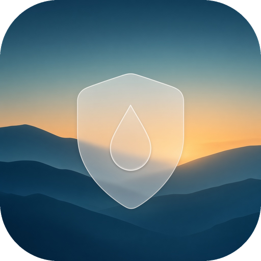

# 脱敏水印

[简体中文](README.md) · [繁體中文](README.zh-Hant.md) · [English](README.en.md) · **日本語** · [한국어](README.ko.md)

**写真に透かしを入れ、撮影情報を削除します。**

ネイティブの Apple Silicon アプリです。HEIF、JPEG、PNG など一般的な形式を、この Mac 上でまとめて処理できます。透かしは画面中央を避けてランダムに置けます。書き出し時は、カメラ情報、撮影日時、位置情報などのメタデータを標準で削除します。

**オフラインで動作し、情報は一切アップロードしません。** 処理はすべてあなたのコンピューター上で行われます。アプリにネットワーク権限はなく、写真、透かし、設定、ファイル名はこの Mac から出ません。

英語名は **Safe Photo Mark** です。必要なハードウェアは **Apple M1 以降**、システムは macOS 14 以降です。インターフェイスは簡体字中国語、繁体字中国語、英語、日本語、韓国語に対応しています。

<p align="center">
  
</p>

## セキュリティとプライバシー

- **オフライン：** ネットワーク権限がなく、通信も行いません。
- **情報は一切アップロードしません：** 写真、透かし、設定、ファイル名はこのコンピューターにだけ残ります。
- **ローカルのみ：** 処理はすべてあなたの Mac 上で行われ、サーバーを経由しません。
- **サンドボックス：** あなたが選んだファイルとフォルダだけを読み書きし、ホームディレクトリへの権限は求めません。
- **元画像は上書きしません：** 結果は指定したフォルダに書き出され、既定で `_safephotomark` が付きます。

## 機能

- **まとめて透かし：** 透明な PNG または SVG を、サイズと不透明度を調整して一度に複数の写真へ重ねます。
- **メタデータの削除（初期状態でオン）：** 撮影パラメータ、日時、位置情報などを削除します。オフにすると撮影情報はできるだけ残しますが、埋め込みサムネイルは削除し、向きは正位置に揃えます。
- **配置：** 「手動 / ランダム / 固定」を一行で切り替え。手動ではプレビュー上でドラッグできます。ランダムでは画面中央 30% を避け、透かし全体がはみ出しません。固定は九分割の位置です。
- **形式：** HEIF/HEIC に特に適しており、JPEG、PNG、TIFF、GIF、BMP、およびシステムが読める WebP にも対応します。JPEG、PNG、HEIF、TIFF、または元画像と同じ形式で書き出せます。
- **ランダムなファイル名：** 出力を 12 桁のランダム名に変え、ファイル名から撮影日が漏れないようにできます。
- **ドラッグ＆ドロップ：** 写真やフォルダをドロップするか、パネルから追加します。一度に最大 2000 枚です。
- **完了音：** 処理の完了時にシステム音を鳴らすこともでき、設定でオフにできます。
- **設定の記憶：** 出力フォルダと透かしのパスを覚え、次回も使えます。

## ダウンロードとインストール

現在のバージョンは **3.0** です。**Apple M1 以降** が必要で、システムは macOS 14 以降です。

1. [Releases](https://github.com/izja16/SafePhotoMark/releases/latest) から `SafePhotoMark-3.0.dmg` を入手します。
2. ディスクイメージを開き、「脱敏水印」を「アプリケーション」フォルダにドラッグします。
3. 初回は、アイコンを**右クリック（または Control クリック）して「開く」**を選び、確認します。このパッケージは Apple の公証を受けていないため、通常のダブルクリックはブロックされることがあります。アプリが壊れているわけではありません。

紹介ページ：[izja16.github.io/SafePhotoMark](https://izja16.github.io/SafePhotoMark/)

## 対応形式

**入力：** JPEG、PNG、HEIF/HEIC（`.heic`、`.heif`、`.hif`）、TIFF、GIF、BMP、および macOS 14+ が読める WebP。

**出力：** JPEG、PNG、HEIF（`.heic`）、TIFF。「元画像と同じ」を選ぶと、JPEG / PNG / HEIF / TIFF はそれぞれの形式を維持します。GIF、BMP、および判別できない形式は JPEG、WebP は PNG で書き出します（このアプリは WebP を書き出さないため、透明を保てます）。

GIF と複数フレームの HEICS は、最初のフレームだけを書き出します。

## 削除されるメタデータ

「メタデータを削除」は初期状態でオンです。オンのとき、出力は新規ファイルとして書き出され、元画像からメタデータはコピーしません。対象は次のとおりです。

- 撮影パラメータ（カメラ、レンズ、シャッター、絞り、ISO、焦点距離などの EXIF）
- 撮影日時
- 位置情報（GPS）
- 説明、キーワード、著作権などの IPTC/XMP
- メーカー独自データ（MakerNote）
- 埋め込みサムネイルとその他の付加情報
- カメラの ICC プロファイル（出力は sRGB に統一）

オフにすると撮影情報はできるだけ残しますが、向きは正位置に揃え、埋め込みサムネイルは削除します。透かしのないプレビューが残らないようにするためです。

16 ビットや Display P3 などの広色域の元画像は、8 ビット sRGB に変換してから処理します。現時点では「元の色空間を維持」するスイッチはありません。一度に読み込めるのは最大 2000 枚です。キャンセルすると未完了の処理だけが止まり、すでに書き出したファイルは元に戻りません。

## ランダム配置

- 透かしはキャンバス内に完全に収まる必要があります。
- ランダムモードでは、透かしの中心が写真の中央 30% × 30% を避けます。
- 透かしが大きすぎて、その条件で置ける場所がないときは、キャンバス内の任意の合法な位置にランダムに置きます。
- 各写真の位置は記憶され、プレビューでドラッグでき、書き出しでも同じ位置を使います。

固定位置は九分割（中央を含む）で、短辺の約 4% の余白を取ります。

## 権限

アプリはサンドボックスで動作し、あなたが選んだファイルとフォルダの読み書きだけを求め、ホームディレクトリやネットワークの権限は求めません。前回の出力フォルダと透かしのパスは、セキュリティスコープ付きブックマークとして記憶されます。

## ソースからビルドする

**Xcode 16 以降**（プロジェクトは Swift 6）と、**Apple M1 以降** の Mac が必要です。プロジェクトフォルダをコンピューターにコピーし、`SafePhotoMark.xcodeproj` を開き、“My Mac” と Scheme **SafePhotoMark** を選んで ⌘R を押します。

プロジェクトは既定で Sign to Run Locally を使うため、最初に開発チームを選ぶ必要はなく、この Mac で実行する場合に適しています。初回起動時、Xcode は同梱のローカル Swift パッケージ `Vendor/SwiftDraw` を解決し、ネットワーク接続は不要です。

SVG の透かしは、同梱の [SwiftDraw](https://github.com/swhitty/SwiftDraw)（zlib ライセンス）でラスタライズし、対象サイズで再描画します。一般的な SVG には対応しますが、完全な SVG 2 ではありません。

```
SafePhotoMark.xcodeproj/    Xcode プロジェクト（共有 Scheme を含む）
SafePhotoMark/              アプリのソース、リソース、権限、Info.plist
SafePhotoMarkTests/         ユニットテスト
Vendor/SwiftDraw/           同梱の SVG ライブラリ（ローカル Swift Package）
docs/                       紹介ページとアイコン
README.md                   简体中文
README.zh-Hant.md           繁體中文
README.en.md                English
README.ja.md                日本語
README.ko.md                한국어
LICENSE
```

## ライセンス

このプロジェクトは [MIT License](LICENSE) で公開されています。同梱の SwiftDraw は zlib ライセンスです。詳細は `Vendor/SwiftDraw/` を参照してください。

## 連絡先

ご質問やご提案は [izja16xyz@gmail.com](mailto:izja16xyz@gmail.com) までどうぞ。
