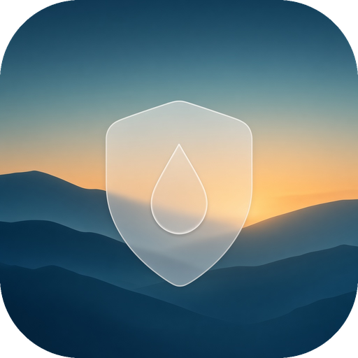

# 脱敏水印

[简体中文](README.md) · [繁體中文](README.zh-Hant.md) · [English](README.en.md) · [日本語](README.ja.md) · **한국어**

**사진에 워터마크를 넣고, 노출될 수 있는 촬영 정보를 지웁니다.**

네이티브 Apple Silicon 앱입니다. HEIF, JPEG, PNG 등 일반적인 형식을 이 Mac에서 일괄 처리합니다. 워터마크는 화면 중앙을 피해 무작위로 놓을 수 있으며, 내보낼 때는 카메라 정보, 촬영 시각, 위치 등의 메타데이터를 기본으로 제거합니다.

**오프라인으로 실행되며, 어떤 정보도 업로드하지 않습니다.** 모든 처리는 당신의 컴퓨터에서만 이루어집니다. 앱에 네트워크 권한이 없어 사진, 워터마크, 설정, 파일 이름은 이 Mac을 떠나지 않습니다.

영어 이름은 **Safe Photo Mark**입니다. 하드웨어 요구 사항은 **Apple M1 이상**이며, 시스템은 macOS 14 이상입니다. 인터페이스는 중국어 간체, 중국어 번체, 영어, 일본어, 한국어를 지원합니다.

<p align="center">
  
</p>

## 보안과 개인정보

- **오프라인:** 네트워크 권한이 없으며, 네트워크 요청도 하지 않습니다.
- **어떤 정보도 업로드하지 않음:** 사진, 워터마크, 설정, 파일 이름은 이 컴퓨터에만 남습니다.
- **로컬에서만 실행:** 모든 처리는 당신의 Mac에서 이루어지며, 서버를 거치지 않습니다.
- **샌드박스:** 당신이 선택한 파일과 폴더만 읽고 쓰며, 홈 디렉터리 권한은 요청하지 않습니다.
- **원본을 덮어쓰지 않음:** 결과는 지정한 폴더에 저장되며, 기본적으로 `_safephotomark` 접미사가 붙습니다.

## 기능

- **일괄 워터마크:** 투명 PNG 또는 SVG를 크기와 투명도를 조절해 여러 장에 한 번에 올립니다.
- **메타데이터 제거(기본으로 켜짐):** 촬영 정보, 시각, 위치 등을 지웁니다. 끄면 촬영 정보는 최대한 남기지만, 원본 썸네일은 제거하고 방향은 정방향으로 맞춥니다.
- **위치:** 「수동 / 무작위 / 고정」을 한 줄에서 바꿉니다. 수동에서는 미리보기에서 드래그할 수 있고, 무작위는 화면 중앙 30%를 피하며 워터마크가 화면 밖으로 나가지 않습니다. 고정은 9분할 위치입니다.
- **형식:** HEIF/HEIC에 특히 적합하며, JPEG, PNG, TIFF, GIF, BMP와 시스템이 읽을 수 있는 WebP도 지원합니다. JPEG, PNG, HEIF, TIFF 또는 원본과 같은 형식으로 내보낼 수 있습니다.
- **무작위 파일 이름:** 출력 파일을 12자리 무작위 이름으로 바꿔, 파일 이름에서 촬영 날짜가 드러나지 않게 할 수 있습니다.
- **드래그 앤 드롭:** 사진이나 폴더를 끌어다 놓거나 선택 패널을 사용할 수 있습니다. 한 번에 최대 2000장입니다.
- **완료 알림음:** 일괄 처리가 끝나면 시스템 알림음을 재생할 수 있으며, 설정에서 끌 수 있습니다.
- **설정 기억:** 출력 폴더와 워터마크 경로를 기억해 다음에도 사용할 수 있습니다.

## 다운로드와 설치

현재 버전은 **3.0**이며, **Apple M1 이상**과 macOS 14 이상이 필요합니다.

1. [Releases](https://github.com/izja16/SafePhotoMark/releases/latest)에서 `SafePhotoMark-3.0.dmg`를 받습니다.
2. 디스크 이미지를 열고 「脱敏水印」을 응용 프로그램 폴더로 끌어다 놓습니다.
3. 처음 열 때는 아이콘을 **우클릭(또는 Control-클릭)한 뒤 「열기」**를 선택하고 확인합니다. 이 설치 파일은 Apple 공증을 받지 않아, 그냥 더블클릭하면 시스템에서 막을 수 있습니다. 앱이 손상된 것은 아닙니다.

소개 페이지: [izja16.github.io/SafePhotoMark](https://izja16.github.io/SafePhotoMark/)

## 지원 형식

**입력:** JPEG, PNG, HEIF/HEIC(`.heic`, `.heif`, `.hif`), TIFF, GIF, BMP, 그리고 macOS 14+가 읽을 수 있는 WebP.

**출력:** JPEG, PNG, HEIF(`.heic`), TIFF. 「원본과 동일」을 선택하면 JPEG / PNG / HEIF / TIFF는 해당 형식을 유지합니다. GIF, BMP 및 인식할 수 없는 형식은 JPEG로, WebP는 PNG로 내보냅니다(이 앱은 WebP를 쓰지 않아 투명을 유지할 수 있습니다).

GIF와 여러 프레임 HEICS는 첫 프레임만 내보냅니다.

## 제거되는 메타데이터

「메타데이터 제거」는 기본으로 켜져 있습니다. 켜져 있으면 출력은 새 파일로 기록되며, 원본에서 메타데이터를 복사하지 않습니다. 대상은 다음과 같습니다.

- 촬영 정보(카메라, 렌즈, 셔터, 조리개, ISO, 초점 거리 등 EXIF)
- 촬영 시각
- 위치(GPS)
- 설명, 키워드, 저작권 등 IPTC/XMP
- 제조사 고유 데이터(MakerNote)
- 원본 썸네일 및 기타 부가 정보
- 카메라 ICC 프로필(출력은 sRGB로 통일)

끄면 촬영 정보는 최대한 남기지만, 방향은 정방향으로 맞추고 원본 썸네일은 제거합니다. 워터마크가 없는 미리보기가 남지 않게 하기 위해서입니다.

16비트와 Display P3 같은 광색역 원본은 8비트 sRGB로 변환한 뒤 처리합니다. 현재는 「원본 색 공간 유지」 스위치가 없습니다. 한 번에 최대 2000장을 가져올 수 있습니다. 취소하면 아직 끝나지 않은 작업만 멈추며, 이미 저장된 파일은 되돌려지지 않습니다.

## 무작위 위치

- 워터마크는 캔버스 안에 완전히 들어와야 합니다.
- 무작위 모드에서는 워터마크의 중심이 사진 정중앙 30% × 30% 영역을 피합니다.
- 워터마크가 너무 커서 그 조건으로 놓을 자리가 없으면, 캔버스 안 임의의 유효한 위치에 무작위로 놓습니다.
- 각 사진의 위치는 기억되며, 미리보기에서 드래그할 수 있고, 내보낼 때도 같은 위치를 사용합니다.

고정 위치는 9분할(중앙 포함)이며, 짧은 변의 약 4%를 여백으로 둡니다.

## 권한

앱은 샌드박스에서 실행되며, 당신이 선택한 파일과 폴더의 읽기/쓰기 권한만 요청하고, 홈 디렉터리나 네트워크 권한은 요청하지 않습니다. 마지막으로 사용한 출력 폴더와 워터마크 경로는 보안 범위 북마크로 기억됩니다.

## 소스에서 빌드하기

**Xcode 16 이상**(프로젝트는 Swift 6)과 **Apple M1 이상** Mac이 필요합니다. 프로젝트 폴더를 컴퓨터에 복사한 뒤 `SafePhotoMark.xcodeproj`를 열고, “My Mac”과 Scheme **SafePhotoMark**를 선택한 다음 ⌘R을 누르면 됩니다.

프로젝트는 기본적으로 Sign to Run Locally를 사용하므로 먼저 개발 팀을 고를 필요는 없으며, 이 Mac에서 실행할 때만 적합합니다. 처음 열면 Xcode가 포함된 로컬 Swift 패키지 `Vendor/SwiftDraw`를 해석하며, 네트워크 연결은 필요 없습니다.

SVG 워터마크는 포함된 [SwiftDraw](https://github.com/swhitty/SwiftDraw)(zlib 라이선스)로 래스터화한 뒤 대상 크기로 다시 그립니다. 일반적인 SVG는 다루지만, 완전한 SVG 2는 아닙니다.

```
SafePhotoMark.xcodeproj/    Xcode 프로젝트(공유 Scheme 포함)
SafePhotoMark/              앱 소스, 리소스, 권한, Info.plist
SafePhotoMarkTests/         단위 테스트
Vendor/SwiftDraw/           포함된 SVG 라이브러리(로컬 Swift Package)
docs/                       소개 페이지와 아이콘
README.md                   简体中文
README.zh-Hant.md           繁體中文
README.en.md                English
README.ja.md                日本語
README.ko.md                한국어
LICENSE
```

## 라이선스

이 프로젝트는 [MIT License](LICENSE)로 공개됩니다. 포함된 SwiftDraw는 zlib 라이선스이며, 설명은 `Vendor/SwiftDraw/`를 참고하세요.

## 연락

문의나 제안은 [izja16xyz@gmail.com](mailto:izja16xyz@gmail.com)으로 보내 주세요.
