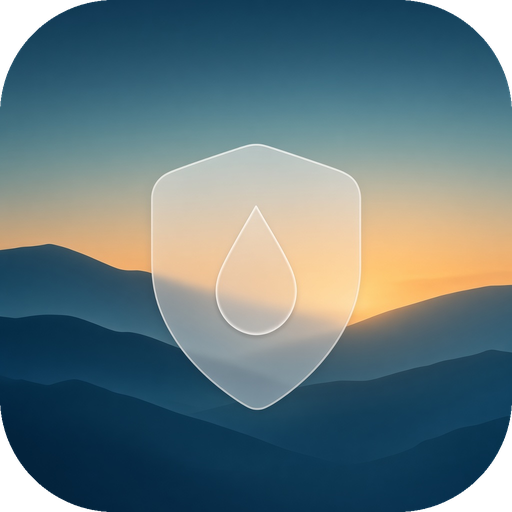

# 脱敏水印

**简体中文** · [繁體中文](README.zh-Hant.md) · [English](README.en.md) · [日本語](README.ja.md) · [한국어](README.ko.md)

**给照片加水印，并清掉会暴露你的拍摄信息。**

原生 Apple Silicon 应用，在本地批量处理 HEIF、JPEG、PNG 等常见格式。水印可以随机避开画面中心，导出时默认移除相机参数、拍摄时间和地理位置。

**不联网，不上传任何信息。** 全部处理都在你的电脑上完成：应用没有网络权限，照片、水印、设置和文件名都不会离开这台 Mac。

英文名 **Safe Photo Mark**。硬件需求为 **Apple M1 及以上**，系统为 macOS 14 或更新版本。界面提供简体中文、繁体中文、英语、日语和韩语。

<p align="center">
  
</p>

## 安全与隐私

- **不联网**：应用没有网络权限，也不会发起网络请求。
- **不上传任何信息**：照片、水印、设置和文件名都只留在这台电脑上。
- **只在本地运行**：全部处理都在你的 Mac 上完成，不经过任何服务器。
- **沙盒限制**：只读写你选中的文件和文件夹，不申请主目录权限。
- **不覆盖原图**：结果写到你指定的文件夹，默认加上 `_safephotomark` 后缀。

## 功能

- **批量加水印**：透明 PNG 或 SVG，可调大小和透明度，一次处理多张照片。
- **移除元数据（默认开启）**：清除拍摄参数、时间、地理位置等；关闭后会尽量保留拍摄信息，但仍会去掉原图缩略图，并把方向改成正向。
- **位置**：一行切换「手动 / 随机 / 固定」。手动可在预览里拖动；随机会避开画面中心 30% 区域，且水印始终不出画；固定使用九宫格方位。
- **格式**：尤其适合 HEIF/HEIC，也支持 JPEG、PNG、TIFF、GIF、BMP，以及系统能读取的 WebP。输出可选 JPEG、PNG、HEIF、TIFF，或与原图相同。
- **随机重命名**：可把输出改成 12 位随机文件名，避免文件名里的拍摄日期。
- **拖放导入**：可拖入照片或文件夹，也可用「选择照片」。单次最多 2000 张。
- **处理完成提示音**：批处理结束后可播放系统提示音，能在设置里关闭。
- **记住设置**：输出文件夹和水印路径会记住，下次打开还能用。

## 下载与安装

当前版本 **3.0**，需要 **Apple M1 及以上**，系统为 macOS 14 或更新版本。

1. 从 [Releases](https://github.com/izja16/SafePhotoMark/releases/latest) 下载 `SafePhotoMark-3.0.dmg`。
2. 打开磁盘映像，把「脱敏水印」拖到「应用程序」文件夹。
3. 第一次打开时，请在图标上**右键（或 Control-点击）选择「打开」**，并在提示中确认。安装包尚未经 Apple 公证，直接双击可能会被系统拦截；这不是应用损坏。

介绍页：[izja16.github.io/SafePhotoMark](https://izja16.github.io/SafePhotoMark/)

## Android 版本（公测）

Android 版已同步到 **3.0**，适配手机和平板，同样**不联网，不上传任何信息**。当前仅为公测，已知问题还比较多，正式版敬请期待。

需要 **Android 8.0 或更新版本**。从 [Releases](https://github.com/izja16/SafePhotoMark/releases/latest) 下载 `SafePhotoMark-3.0.apk`。安装时若系统提示「禁止安装未知来源应用」，请按提示允许，这不是应用损坏。

源码在仓库的 [`android/`](android/) 目录。

## 支持的格式

**输入：** JPEG、PNG、HEIF/HEIC（`.heic`、`.heif`、`.hif`）、TIFF、GIF、BMP，以及 macOS 14+ 能读取的 WebP。

**输出：** JPEG、PNG、HEIF（`.heic`）、TIFF。选择「与原图相同」时，JPEG / PNG / HEIF / TIFF 保持对应格式；GIF、BMP 及无法识别的格式导出为 JPEG；WebP 导出为 PNG（本应用不写出 WebP，这样可保留透明通道）。

GIF 和多帧 HEICS 都只导出第一帧。

## 元数据会移除什么

「移除元数据」默认开启。开启时，输出是全新写入的文件，不会从原图拷贝元数据，包括：

- 拍摄参数（相机、镜头、快门、光圈、ISO、焦距等 EXIF）
- 拍摄时间
- 地理位置（GPS）
- 描述、关键词、版权等 IPTC/XMP
- 厂家私有数据（MakerNote）
- 原图缩略图及其他附加信息
- 相机自带的 ICC 颜色配置文件（输出统一为 sRGB）

关闭后会尽量保留拍摄信息，但方向标签仍会改成正向，原图缩略图仍会去掉，以免带出未加水印的预览。

16 位和 Display P3 等广色域原图会转换为 8 位 sRGB 后再处理，目前没有「保持源色彩空间」的开关。一次最多导入 2000 张；取消只会停止尚未完成的任务，已经写出的文件不会回滚。

## 随机位置

- 水印必须完整落在画布内。
- 随机模式下，水印中心会避开照片正中 30% × 30% 的区域。
- 若水印太大、避开中心后没有合法位置，则在画布内任意合法位置随机。
- 每张照片的位置会记住，可在预览里拖动，导出使用同一位置。

固定位置使用九宫格（含居中），并留出约 4% 短边的边距。

## 权限

应用开启沙盒，只申请你选中的文件和文件夹的读写权限，不申请主目录或网络权限。上次使用的输出文件夹和水印路径会以安全作用域书签记住。

## 从源码编译

需要 **Xcode 16 或更新版本**（工程使用 Swift 6），以及 **Apple M1 及以上** 的 Mac。把整个项目文件夹拷到电脑上，打开 `SafePhotoMark.xcodeproj`，选择 “My Mac” 和 Scheme **SafePhotoMark**，按 ⌘R 即可。

工程默认使用 Sign to Run Locally，不必先选开发团队，只适合本机运行。首次打开时，Xcode 会解析内嵌的本地 Swift 包 `Vendor/SwiftDraw`，不需要联网。

SVG 水印由内嵌的 [SwiftDraw](https://github.com/swhitty/SwiftDraw)（zlib 许可）光栅化，并按目标尺寸重新绘制。它覆盖常见 SVG，但不是完整的 SVG 2。

```
SafePhotoMark.xcodeproj/    Xcode 工程（含共享 Scheme）
SafePhotoMark/              应用源码、资源、权限与 Info.plist
SafePhotoMarkTests/         单元测试
Vendor/SwiftDraw/           内嵌 SVG 库（本地 Swift Package）
docs/                       介绍页和图标
README.md                   简体中文
README.zh-Hant.md           繁體中文
README.en.md                English
README.ja.md                日本語
README.ko.md                한국어
LICENSE
android/                    Android 版源码（公测）
```

## 许可证

本项目采用 [MIT License](LICENSE) 开源。内嵌的 SwiftDraw 使用 zlib 许可，说明见 `Vendor/SwiftDraw/`。

## 联系

有问题或建议，欢迎写信到 [izja16xyz@gmail.com](mailto:izja16xyz@gmail.com)。
