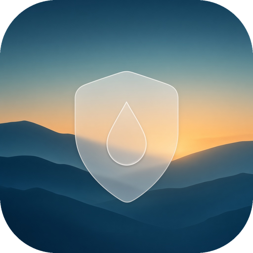

# 脱敏水印

[简体中文](README.md) · **繁體中文** · [English](README.en.md) · [日本語](README.ja.md) · [한국어](README.ko.md)

**為照片加上浮水印，並清掉會暴露你的拍攝資訊。**

原生 Apple Silicon 應用程式，在本機批次處理 HEIF、JPEG、PNG 等常見格式。浮水印可以隨機避開畫面中心，匯出時預設移除相機參數、拍攝時間和地理位置。

**不連網，不上傳任何資訊。** 全部處理都在你的電腦上完成：應用程式沒有網路權限，照片、浮水印、設定和檔名都不會離開這台 Mac。

英文名 **Safe Photo Mark**。硬體需求為 **Apple M1 及以上**，系統為 macOS 14 或更新版本。介面提供簡體中文、繁體中文、英語、日語和韓語。

<p align="center">
  
</p>

## 安全與隱私

- **不連網**：應用程式沒有網路權限，也不會發起網路請求。
- **不上傳任何資訊**：照片、浮水印、設定和檔名都只留在這台電腦上。
- **只在本機執行**：全部處理都在你的 Mac 上完成，不經過任何伺服器。
- **沙盒限制**：只讀寫你選取的檔案和資料夾，不申請主目錄權限。
- **不覆蓋原圖**：結果寫到你指定的資料夾，預設加上 `_safephotomark` 後綴。

## 功能

- **批次加上浮水印**：透明 PNG 或 SVG，可調大小和透明度，一次處理多張照片。
- **移除中繼資料（預設開啟）**：清除拍攝參數、時間、地理位置等；關閉後會盡量保留拍攝資訊，但仍會去掉原圖縮圖，並把方向改成正向。
- **位置**：一行切換「手動 / 隨機 / 固定」。手動可在預覽裡拖曳；隨機會避開畫面中心 30% 區域，且浮水印始終不出界；固定使用九宮格方位。
- **格式**：尤其適合 HEIF/HEIC，也支援 JPEG、PNG、TIFF、GIF、BMP，以及系統能讀取的 WebP。輸出可選 JPEG、PNG、HEIF、TIFF，或與原圖相同。
- **隨機重新命名**：可把輸出改成 12 位隨機檔名，避免檔名裡的拍攝日期。
- **拖放匯入**：可拖入照片或資料夾，也可用「選擇照片」。單次最多 2000 張。
- **處理完成提示音**：批次處理結束後可播放系統提示音，能在設定裡關閉。
- **記住設定**：輸出資料夾和浮水印路徑會記住，下次打開還能用。

## 下載與安裝

目前版本 **3.0**，需要 **Apple M1 及以上**，系統為 macOS 14 或更新版本。

1. 從 [Releases](https://github.com/izja16/SafePhotoMark/releases/latest) 下載 `SafePhotoMark-3.0.dmg`。
2. 打開磁碟映像，把「脱敏水印」拖到「應用程式」資料夾。
3. 第一次打開時，請在圖示上**右鍵（或 Control-點擊）選擇「打開」**，並在提示中確認。安裝包尚未經 Apple 公證，直接點兩下可能會被系統攔截；這不是應用程式損壞。

介紹頁：[izja16.github.io/SafePhotoMark](https://izja16.github.io/SafePhotoMark/)

## Android 版本（公測）

Android 版已同步到 **3.0**，適配手機和平板，同樣**不連網，不上傳任何資訊**。目前僅為公測，已知問題還比較多，正式版敬請期待。

需要 **Android 8.0 或更新版本**。從 [Releases](https://github.com/izja16/SafePhotoMark/releases/latest) 下載 `SafePhotoMark-3.0.apk`。安裝時若系統提示「禁止安裝未知來源應用程式」，請依提示允許，這不是應用程式損壞。

原始碼在倉庫的 [`android/`](android/) 目錄。

## 支援的格式

**輸入：** JPEG、PNG、HEIF/HEIC（`.heic`、`.heif`、`.hif`）、TIFF、GIF、BMP，以及 macOS 14+ 能讀取的 WebP。

**輸出：** JPEG、PNG、HEIF（`.heic`）、TIFF。選擇「與原圖相同」時，JPEG / PNG / HEIF / TIFF 保持對應格式；GIF、BMP 及無法識別的格式匯出為 JPEG；WebP 匯出為 PNG（本應用程式不寫出 WebP，這樣可保留透明通道）。

GIF 和多幀 HEICS 都只匯出第一幀。

## 中繼資料會移除什麼

「移除中繼資料」預設開啟。開啟時，輸出是全新寫入的檔案，不會從原圖複製中繼資料，包括：

- 拍攝參數（相機、鏡頭、快門、光圈、ISO、焦距等 EXIF）
- 拍攝時間
- 地理位置（GPS）
- 描述、關鍵詞、版權等 IPTC/XMP
- 廠商私有資料（MakerNote）
- 原圖縮圖及其他附加資訊
- 相機自帶的 ICC 色彩描述檔（輸出統一為 sRGB）

關閉後會盡量保留拍攝資訊，但方向標籤仍會改成正向，原圖縮圖仍會去掉，以免帶出未加浮水印的預覽。

16 位和 Display P3 等廣色域原圖會轉換為 8 位 sRGB 後再處理，目前沒有「保持來源色彩空間」的開關。一次最多匯入 2000 張；取消只會停止尚未完成的任務，已經寫出的檔案不會還原。

## 隨機位置

- 浮水印必須完整落在畫布內。
- 隨機模式下，浮水印中心會避開照片正中 30% × 30% 的區域。
- 若浮水印太大、避開中心後沒有合法位置，則在畫布內任意合法位置隨機。
- 每張照片的位置會記住，可在預覽裡拖曳，匯出使用同一位置。

固定位置使用九宮格（含置中），並留出約 4% 短邊的邊距。

## 權限

應用程式開啟沙盒，只申請你選取的檔案和資料夾的讀寫權限，不申請主目錄或網路權限。上次使用的輸出資料夾和浮水印路徑會以安全作用域書籤記住。

## 從原始碼編譯

需要 **Xcode 16 或更新版本**（工程使用 Swift 6），以及 **Apple M1 及以上** 的 Mac。把整個專案資料夾拷到電腦上，打開 `SafePhotoMark.xcodeproj`，選擇 “My Mac” 和 Scheme **SafePhotoMark**，按 ⌘R 即可。

工程預設使用 Sign to Run Locally，不必先選開發團隊，只適合本機執行。首次打開時，Xcode 會解析內嵌的本地 Swift 套件 `Vendor/SwiftDraw`，不需要連網。

SVG 浮水印由內嵌的 [SwiftDraw](https://github.com/swhitty/SwiftDraw)（zlib 授權）光柵化，並依目標尺寸重新繪製。它涵蓋常見 SVG，但不是完整的 SVG 2。

```
SafePhotoMark.xcodeproj/    Xcode 工程（含共享 Scheme）
SafePhotoMark/              應用程式原始碼、資源、權限與 Info.plist
SafePhotoMarkTests/         單元測試
Vendor/SwiftDraw/           內嵌 SVG 函式庫（本地 Swift Package）
docs/                       介紹頁和圖示
README.md                   简体中文
README.zh-Hant.md           繁體中文
README.en.md                English
README.ja.md                日本語
README.ko.md                한국어
LICENSE
android/                    Android 版原始碼（公測）
```

## 授權

本專案採用 [MIT License](LICENSE) 開源。內嵌的 SwiftDraw 使用 zlib 授權，說明見 `Vendor/SwiftDraw/`。

## 聯絡

有問題或建議，歡迎寫信到 [izja16xyz@gmail.com](mailto:izja16xyz@gmail.com)。
